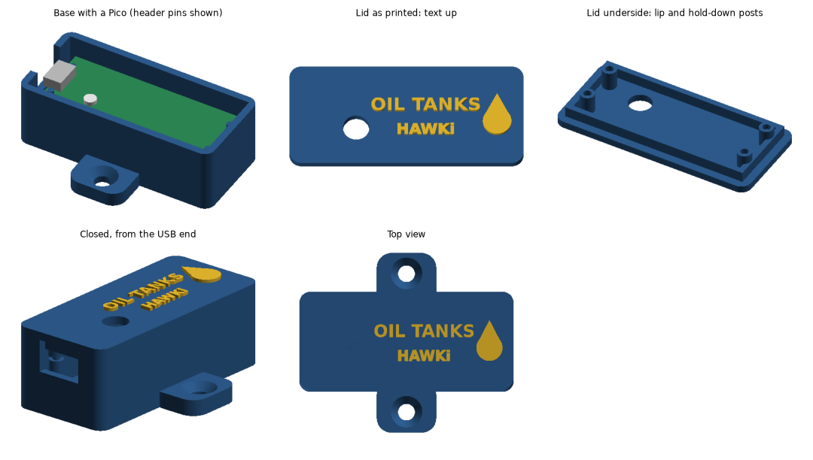

# Case

A wall- or beam-mounted case for the Pico 2 W, with or without headers. 

| File (`out/`) | What |
|---|---|
| `hawki_base.stl` | Base. Print open side up, no supports. |
| `hawki_lid_2colour.3mf` | Lid with the text as a second object: give the text its own filament (AMS/MMU). |
| `hawki_lid.stl` + `hawki_lid_text.stl` | The same lid as two STLs, if your slicer prefers. |

**Two colours on a single-nozzle printer:** print the lid text side up and add a filament change (M600 / "pause") at **2.0 mm**: the first layer of the text.

**Settings:** PETG, 0.2 mm layers, 3 walls, 20% infill. Outside: 57.5 × 26.2 × 18.5 mm, 48 mm wide across the screw ears. Use about 4 mm countersunk wood screws.

**Fitting:**
- Drop the Pico onto the four pegs, USB end towards the opening. The pegs hold it 10 mm up, so soldered headers fit underneath.
- Push the lid on: its posts hold the board down. The lid is a friction fit, so prise it off at the corners.
- The hole in the lid sits over the BOOTSEL button. Holding BOOTSEL for 5 seconds with a pen clears a forgotten PIN.

**Changing it:** sizes are at the top of `make_case.py` (`python3 case/make_case.py`; needs `trimesh manifold3d shapely matplotlib`). For example:
- `BOOTSEL_X/Y`: where the button hole goes;
- `LIP_CLR`: a looser or tighter lid;
- `TEXT`, `SUB`: the words on the lid.
